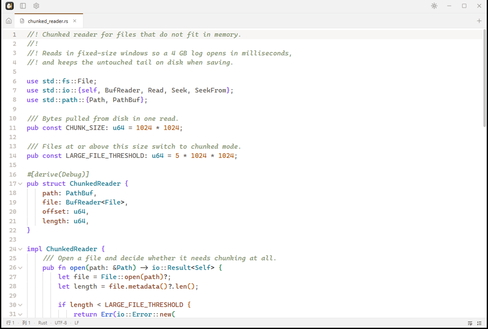

<div align="center">


# Sesame

**A fast, lightweight text editor and file viewer for the desktop.**

Opens instantly, stays out of the way, and handles the files other editors choke on —
huge logs, GBK-encoded configs, a stray PNG you just want to look at.

[](#license)
[](#install)
[](https://tauri.app)
[](#why-it-stays-small)

[English](README.md) · [简体中文](README.zh-CN.md)



</div>

---

## Why Sesame

Most text editors make you choose between a toy that can't open your logs and an IDE
that takes four seconds to start. Sesame is for the third case: you want to **look at a
file, or change three lines in it**, right now.

- **It opens.** No splash screen, no project indexing, no "loading workspace".
- **It doesn't lose your work.** Every save is atomic, and unsaved edits are backed up
  continuously — a crash or a force-quit won't cost you anything.
- **It doesn't corrupt your files.** The encoding, line endings and BOM you opened with
  are the ones written back. Binary files are refused, not mangled.
- **It handles files that don't fit in memory.** Files over 5 MB are read in 1 MB
  chunks, and saving streams the untouched tail straight from disk instead of pulling
  it into memory. Saving is capped at 256 MB per write.

## Features

| | |
| --- | --- |
| **Syntax highlighting** | 18 languages via CodeMirror 6, loaded lazily — they cost nothing until you open one |
| **Large files** | Files over 5 MB load in 1 MB chunks; saving streams the untouched tail back from disk instead of reading it into memory (writes capped at 256 MB) |
| **Encodings** | Detected on open (BOM → strict UTF-8 → GBK, including UTF-16 via BOM) and written back exactly as found. Detection isn't perfect — click the encoding in the status bar to reopen with a different one |
| **Line endings** | LF, CRLF and CR preserved per file — no silent conversion |
| **Safety net** | Atomic writes, external-modification detection, autosave, and always-on draft backup for untitled buffers |
| **Multi-tab** | Drag to reorder, per-tab cursor and scroll position, session restore on relaunch, reopen a closed tab with `Ctrl+Shift+T` |
| **Markdown preview** | Rendered and sanitized with DOMPurify; external links open in your browser, not inside the app |
| **Image viewer** | Ctrl + wheel to zoom, Space + drag to pan, rotate, flip, reset, fit-to-window, actual size, choose an external app; dimensions, file size, and format in the status bar |
| **Find & replace** | Regex, case-sensitive, whole-word and cross-line search, with replace |
| **Indent guides** | Faint vertical rules at each indent level; on by default, toggle in settings |
| **Rainbow brackets** | Colour brackets by nesting depth; on by default, toggle in settings |
| **Memory-friendly** | Tabs you haven't touched release their editor instances after a while, and restore instantly when you come back |
| **Theming** | 13 built-in themes (light and dark), each colouring the interface, the editor and syntax highlighting together; UI and editor fonts configurable separately |
| **Interface language** | English and Simplified Chinese, following your system language by default |
| **Auto-update** | Checks silently on launch and installs signed updates from within the app |

### Why it stays small

The Windows installer is about **2.1 MB** (the executable itself is 4.8 MB; the
installer compresses it). Sesame uses the operating system's own webview
(WebView2 on Windows, WKWebView on macOS) rather than bundling a browser engine — which
is also why it starts as fast as it does.

### Platform support

**Windows and macOS only.** Both are supported by the same codebase; the differences are
handled in `src/lib/utils/platform.ts`.

Linux is not a target. The window chrome, file associations and packaging formats differ
across desktop environments there, and the maintenance cost outweighed the benefit for a
project of this size.

## Install

### Download an installer

Grab the latest from the [Releases page](https://github.com/aeroray/Sesame/releases):

| Platform | File |
| --- | --- |
| Windows (x64) | `Sesame_<version>_x64-setup.exe` |
| macOS (Apple Silicon) | `Sesame_<version>_aarch64.dmg` |

The Windows installer can register Sesame as the default handler for the text and image
formats it supports; that is a checkbox during setup, and you can skip it.

> **The macOS build is unsigned and not notarized** — no Apple Developer certificate is
> involved in this project. macOS will refuse to open it on first launch. Either
> right-click the app in Finder and choose **Open**, or run:
>
> ```bash
> xattr -rd com.apple.quarantine /Applications/Sesame.app
> ```
>
> This clears the quarantine flag on your machine only; it is not a substitute for Apple
> code signing. Windows builds are unaffected.

Only Apple Silicon (`aarch64`) macOS builds are published. Intel Macs are not targeted.

### Build from source

**Prerequisites**

- [Rust](https://rustup.rs) 1.90 or newer
- [Node.js](https://nodejs.org) 20 or newer, with [pnpm](https://pnpm.io)
- Your platform's Tauri dependencies — see the
  [Tauri prerequisites guide](https://v2.tauri.app/start/prerequisites/). On Windows
  this means the **C++ Build Tools** and **WebView2** (preinstalled on Windows 11).
  On macOS you need Xcode Command Line Tools; WKWebView is part of the system.

**Build**

```sh
git clone https://github.com/aeroray/Sesame.git
cd Sesame
pnpm install
pnpm tauri build
```

The installer lands in `src-tauri/target/release/bundle/`.

> **Windows is the tested platform.** The macOS build is expected to work — the only
> platform-specific code is the title bar and the Cmd-key handling — but it has not been
> verified on real hardware. If you build it on a Mac, please report what you find.

**Run in development**

```sh
pnpm tauri dev
```

## Auto-update

Sesame checks for updates **silently on launch** and, when one is found, shows it under
**Settings → About**, with the release notes and a one-click install. Nothing is
downloaded or installed without you clicking that button.

Update packages are signed with [minisign](https://jedisct1.github.io/minisign/). The
public key is compiled into the app and the signature is verified in Rust before anything
is installed, so a tampered update server cannot push a modified build — it produces a
signature failure instead. Note that the release notes are *not* covered by that
signature, which is why they are rendered as plain text and never as HTML.

## Usage

Open a file any of four ways:

- **Ctrl+O** — file dialog
- **Drag and drop** it onto the window
- **Pass it on the command line** — `sesame notes.md`
- **Double-click** it, if you registered Sesame as the handler during install

### Keyboard shortcuts

App-level:

| Action | Shortcut |
| --- | --- |
| New tab / Open / Save / Save as | `Ctrl+N` / `Ctrl+O` / `Ctrl+S` / `Ctrl+Shift+S` |
| Close tab | `Ctrl+W` |
| Reopen closed tab | `Ctrl+Shift+T` |
| Copy file path | `Ctrl+Shift+C` |
| Toggle sidebar | `Ctrl+B` |
| Markdown preview | `Ctrl+Shift+M` |
| Next / previous tab | `Ctrl+Tab` / `Ctrl+Shift+Tab` |
| Settings / Shortcuts | `Ctrl+,` / `Ctrl+/` |

In the editor:

| Action | Shortcut |
| --- | --- |
| Find / Find next | `Ctrl+F` / `Ctrl+G` |
| Select all matches | `Ctrl+Shift+L` |
| Go to line | `Ctrl+Alt+G` |
| Autocomplete | `Ctrl+Space` |
| Undo / Redo | `Ctrl+Z` / `Ctrl+Y` |
| Select all | `Ctrl+A` |
| Toggle line comment | `Ctrl+/` |
| Indent / outdent | `Ctrl+]` / `Ctrl+[` |
| Move line up / down | `Alt+↑` / `Alt+↓` |
| Copy line up / down | `Shift+Alt+↑` / `Shift+Alt+↓` |

Press **Ctrl+/** in the app for the same list.

### Opening files from your file manager

Sesame runs as a **single instance**: opening a second file hands it to the window that is
already running rather than starting another copy. Two processes writing the same settings
and session files would overwrite each other's state.

### Your edits are protected in three layers

1. **Manual save** (`Ctrl+S`) — writes back to the original file.
2. **Autosave** (optional) — debounced write-back for files that have a path.
3. **Draft backup** (always on) — unsaved content is written to the app data directory,
   including untitled buffers. Restored silently on next launch.

Saves are atomic: content goes to a temporary file in the same directory, is flushed to
disk, and only then replaces the original. An interrupted save leaves the previous
version intact rather than a half-written file.

If the file changed on disk since you opened it, Sesame tells you and offers to
**overwrite**, **reload from disk**, or **save as** — it will not silently discard
someone else's changes.

Save As also preserves the unread tail of a partially loaded file. Files that cannot
be decoded without losing bytes stay read-only until you select a suitable encoding;
characters that the selected output encoding cannot represent are rejected before writing.
Draft recovery remains enabled even when session restoration is turned off. Older drafts
without a disk baseline recover as untitled documents so they cannot overwrite newer files.

## Configuration

Settings are stored in your platform's app data directory:

| Platform | Location |
| --- | --- |
| Windows | `%APPDATA%\com.sesame.app\` |
| macOS | `~/Library/Application Support/com.sesame.app/` |

`settings.json` holds preferences; `recent.json`, `session.json` and `drafts/` are
managed separately so that clearing your recent-files list never touches your session
or your unsaved work.

## Tech stack

| Layer | Choice |
| --- | --- |
| Shell | [Tauri 2](https://tauri.app) (Rust) |
| UI | [Svelte 5](https://svelte.dev) with runes — no SvelteKit, no SSR, no router |
| Build | [Vite](https://vite.dev) |
| Styling | [Tailwind CSS v4](https://tailwindcss.com) (CSS-first config) |
| Components | [shadcn-svelte](https://shadcn-svelte.com) + [bits-ui](https://bits-ui.com) |
| Editor | [CodeMirror 6](https://codemirror.net) |
| Markdown | [marked](https://marked.js.org) + [DOMPurify](https://github.com/cure53/DOMPurify) |

All file I/O, encoding conversion, language detection and path normalization happen in
Rust; the frontend only passes strings across the IPC boundary.

## Development

```sh
pnpm install        # install dependencies
pnpm tauri dev      # run the app with hot reload
pnpm check          # type-check (svelte-check)
pnpm lint           # lint and format check (Biome)
cargo test --lib    # run the Rust unit tests, from src-tauri/
```

Project documentation lives in [`docs/`](docs/):

- [`docs/design/design.md`](docs/design/design.md) — the single source of truth for
  anything visual. Read this before changing UI.
- [`docs/memory/`](docs/memory/) — architecture decisions, constraints, and project brief.

## Releasing

Pushing a SemVer tag (for example `v1.0.0`) runs
[`.github/workflows/release.yml`](.github/workflows/release.yml), which builds the
Windows NSIS installer and the Apple Silicon DMG, then publishes a GitHub Release with
the signed updater artifacts and `latest.json`. You can also run the workflow manually
against an existing tag.

### The version lives in one place

`package.json` is the **only** file where the version is written. The other two derive
from it:

| File | How it gets the version |
| --- | --- |
| `package.json` | the source of truth |
| `src-tauri/tauri.conf.json` | `"version": "../package.json"` — Tauri reads the file itself |
| `src-tauri/Cargo.toml` | written by `pnpm sync:version` |

So a release is a one-line edit:

```sh
# 1. bump the version — the only place it is written
$EDITOR package.json

# 2. propagate. Runs automatically as a prebuild/predev hook; run it by hand if you
#    build with cargo directly, which bypasses the npm hooks.
pnpm sync:version

# 3. note the release, then tag it
$EDITOR docs/releases/v1.0.0.md   # the release body comes from this file
git commit -am "chore(release): v1.0.0"
git tag v1.0.0 && git push --tags
```

`pnpm version:check` verifies all three agree without writing anything — that is what
CI runs. It also **fails if `tauri.conf.json` stops pointing at `package.json`** and
starts carrying a literal version again, since that is exactly the duplication this
setup removes.

The workflow **fails** if the tag disagrees with `package.json` / `Cargo.toml`, or if
`docs/releases/<tag>.md` is missing or empty. Both are deliberate: a mismatch would
publish an installer whose internal version never matches the tag, and clients would
then report "up to date" forever.

### Required repository secrets

| Secret | Required | Purpose |
| --- | --- | --- |
| `TAURI_SIGNING_PRIVATE_KEY` | **Yes** | Signs updater artifacts. Without it there is no `latest.json`, so no client can ever update. |
| `TAURI_SIGNING_PRIVATE_KEY_PASSWORD` | If the key has one | Password for the private key. |

`GITHUB_TOKEN` is provided by Actions automatically.

Generate the keypair once with `pnpm tauri signer generate -w ~/.tauri/sesame-updater.key`.
The **public** key goes into `plugins.updater.pubkey` in `src-tauri/tauri.conf.json`
(it is not a secret); the **private** key and its password go into the repository
secrets and must never be committed. `.gitignore` ignores `*.key` as a second line of
defence.

> **Keep the private key backed up.** Losing it means you can no longer sign updates for
> anyone who already installed the app — they would have to download a new build by hand.
> Generating a replacement key only works if you also ship it in a build those users
> install manually.

Apple signing and notarization are **not** configured. The macOS DMG ships unsigned,
which is why the install instructions above mention the quarantine flag. Adding an Apple
Developer certificate is orthogonal to the update signing above: the former removes a
system warning, the latter guarantees update integrity. If you do add one, the secrets
Tauri expects are `APPLE_CERTIFICATE`, `APPLE_CERTIFICATE_PASSWORD`,
`APPLE_SIGNING_IDENTITY`, `APPLE_ID`, `APPLE_PASSWORD` and `APPLE_TEAM_ID`, passed as
`env:` on the `tauri-action` step.

## Contributing

Issues and pull requests are welcome. Before opening a PR:

1. Run `pnpm check`, `pnpm lint` and `cargo test --lib` — all three should be clean.
2. If your change affects appearance, read `docs/design/design.md` first and follow it.
3. **All user-facing strings go through the i18n dictionary** (`src/lib/i18n/messages/`).
   Add every new string to *both* `en.ts` and `zh-CN.ts` — a missing translation is a
   type error, not a silent fallback. Keep code comments in Chinese to match the
   existing codebase; comments and log messages are not translated.

## License

[MIT](LICENSE) © Sesame contributors
